<p align="center">
  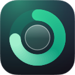
</p>

<h1 align="center">Widgets</h1>

<p align="center">
  <b>Widgets de vidro e uma ilha dinâmica para a área de trabalho do Windows.</b><br>
  O céu da sua cidade, a música que está tocando, o seu PC, o seu GitHub, um Pomodoro, a bateria
  e o uso do Claude, presos ao papel de parede. Leve, bonito e de graça.
</p>

<p align="center">
  <a href="https://github.com/lucasschn1/Widgets/releases/latest/download/Widgets-Setup.exe"></a>
</p>

<p align="center">
  <sub>Grátis · Windows 10 ou 11 · download de 1,5 MB · sem precisar de administrador · <a href="#instalar">como instalar</a></sub>
</p>

<p align="center">
  <a href="https://github.com/lucasschn1/Widgets/releases/latest"></a>
  
  <a href="https://github.com/lucasschn1/Widgets/actions/workflows/release.yml"></a>
  
  <a href="LICENSE"></a>
  <a href="https://github.com/lucasschn1/Widgets/releases"></a>
</p>

<p align="center">
  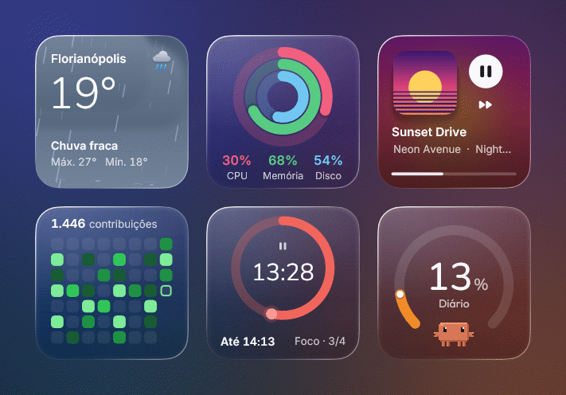
</p>

<p align="center">
  <a href="#instalar"><b>Instalar</b></a>
  &nbsp;·&nbsp;
  <a href="#os-widgets">Os widgets</a>
  &nbsp;·&nbsp;
  <a href="#a-ilha-dinâmica">A ilha dinâmica</a>
  &nbsp;·&nbsp;
  <a href="#por-que-dá-para-confiar">Por que confiar</a>
  &nbsp;·&nbsp;
  <a href="#perguntas-frequentes">Perguntas</a>
</p>

## Em poucas palavras

<table>
  <tr>
    <td width="50%" valign="top">
      <b>Vidro de verdade.</b> O fundo de cada widget é o seu próprio papel de parede desfocado,
      como um vidro fosco. Sem o mouse em cima, eles ficam mais transparentes e não roubam a
      atenção.
    </td>
    <td width="50%" valign="top">
      <b>Uma ilha dinâmica no Windows.</b> Uma pílula na barra de tarefas, como a do iPhone: a
      música, o Pomodoro, o pôr do sol, a Estação Espacial passando e um modo foco.
    </td>
  </tr>
  <tr>
    <td valign="top">
      <b>Leve de verdade.</b> Um único <code>Widgets.exe</code> de 3,5 MB, uns 50 MB de memória e
      menos de 1% do processador. Jogo ou vídeo em tela cheia pausa tudo.
    </td>
    <td valign="top">
      <b>Seu, e só seu.</b> Código aberto, sem conta, sem telemetria e sem anúncios. Cada versão é
      compilada em público pelo GitHub Actions.
    </td>
  </tr>
  <tr>
    <td valign="top">
      <b>Instala em segundos.</b> Sem administrador: vai para a sua pasta de usuário e sai inteiro
      por Configurações → Aplicativos.
    </td>
    <td valign="top">
      <b>Sempre em dia.</b> Quando sai uma versão nova, o app avisa e atualiza com um clique, sem
      perder as suas configurações.
    </td>
  </tr>
</table>

## Instalar

Em três passos:

1. **Baixe o [Widgets-Setup.exe](https://github.com/lucasschn1/Widgets/releases/latest/download/Widgets-Setup.exe)** (1,5 MB).
2. **Abra o arquivo**, avance e clique em **Instalar**. Se aparecer a tela azul "O Windows protegeu o
   computador", clique em **Mais informações** e depois em **Executar assim mesmo**
   ([por que esse aviso aparece](#o-aviso-do-windows)).
3. **Pronto.** Os widgets abrem na área de trabalho, e umas boas-vindas rápidas ajudam a escolher
   quais mostrar e a cidade do clima.

<p align="center">
  <a href="https://github.com/lucasschn1/Widgets/releases/latest/download/Widgets-Setup.exe"></a>
</p>

**Prefere o terminal?** Abra o **PowerShell** e cole a linha abaixo. Ela baixa a última versão
direto do GitHub e instala, sem os avisos do navegador e do SmartScreen:

```powershell
irm https://raw.githubusercontent.com/lucasschn1/Widgets/main/install.ps1 | iex
```

| | |
|---|---|
| **Sistema** | Windows 10 ou 11, 64 bits |
| **Tamanho** | 3,5 MB instalado (um `.exe` só, sem dependências) |
| **Consumo** | Uns 50 MB de memória e pouca CPU (veja [quanto pesa no PC](#quanto-pesa-no-pc)) |
| **Permissões** | Nenhuma de administrador: o app vai para `%LOCALAPPDATA%\Programs\Widgets` |
| **Atualizar** | O próprio app avisa e atualiza com um clique |
| **Desinstalar** | Configurações → Aplicativos → Widgets |

<a id="o-aviso-do-windows"></a>
<details>
<summary><b>O Windows disse que "protegeu o computador" (ou o navegador desconfiou do download)</b></summary>

<br>

Esses avisos aparecem porque as versões ainda saem **sem assinatura digital** (o pedido está em
andamento; veja a [política de assinatura](#code-signing-policy)). O Windows e os navegadores
desconfiam de todo programa novo, sem assinatura, que pouca gente baixou. O aviso não quer dizer
que encontraram algo no arquivo. Se quiser conferir antes, veja
[Por que dá para confiar](#por-que-dá-para-confiar).

**No navegador.** O Edge pode dizer que o arquivo "não é baixado com frequência". Clique nos três
pontinhos ao lado do aviso → **Manter** → **Mostrar mais** → **Manter assim mesmo**. O Chrome
também pode pedir que você confirme o download.

**Ao abrir o instalador.** Uma tela azul diz "O Windows protegeu o computador". É o SmartScreen:
clique em **Mais informações** e depois em **Executar assim mesmo**. Depois de instalado, o app
abre sem esse aviso.

**Pelo terminal, esses dois avisos não aparecem.** O `install.ps1` baixa a versão direto do
GitHub, sem passar pelo navegador.

**Se não houver o botão "Executar assim mesmo".** Nesse caso, quem barrou foi o
**Controle Inteligente de Aplicativos** do Windows 11 (veja se ele está ligado em Segurança do
Windows → Controle de aplicativos e navegador). Ele não abre exceção para um programa e costuma
barrar uma versão recém-lançada nos primeiros dias, até o Windows conhecer o arquivo. Espere
alguns dias e instale de novo; não precisa desligá-lo.

Quem já tem os widgets não corre risco de ficar sem eles. Antes de trocar a versão, o
`install.ps1` e o botão **Atualizar** do app conferem se o Windows deixa a nova abrir. Se não
deixar, os widgets continuam na versão que você tem, e o app avisa o motivo.

</details>

## Por que dá para confiar

- **O código é aberto,** sob a [licença MIT](LICENSE). Tudo o que o app faz está neste
  repositório, e dá para [compilar você mesmo](#compilar).
- **Ninguém compila na própria máquina.** Cada versão é gerada pelo
  [GitHub Actions](https://github.com/lucasschn1/Widgets/actions/workflows/release.yml) a partir
  do código público da tag, depois de passar em centenas de testes automáticos. O registro de
  cada build fica aberto.
- **Dá para conferir o arquivo.** A página de cada Release mostra o SHA-256 dos arquivos.
  Compare com o do que você baixou: `Get-FileHash .\Widgets-Setup.exe`.
- **Sem administrador, sem serviço, sem driver.** O app roda como um programa comum, com as
  permissões do seu usuário, e sai inteiro pela desinstalação.
- **Sem conta, sem telemetria e sem anúncios.** O app não manda nada sobre você para lugar
  nenhum; a seção [Privacidade](#privacidade) lista exatamente com quem ele conversa, e o
  instalador mostra esse resumo antes de instalar.

## Os widgets

Sete widgets, cada um em três tamanhos que se encaixam como peças. Escolha quais aparecem na
Galeria de widgets (clique direito → Configurações).

<p align="center">
  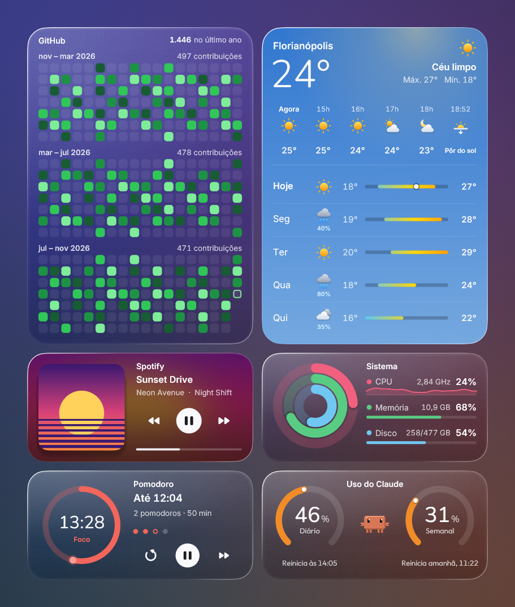
</p>

| Widget | O que mostra |
|---|---|
| [**Tempo**](#tempo) | O céu de agora animado, as próximas horas e os próximos dias |
| [**Sistema**](#sistema) | CPU, memória e disco em anéis, com os apps que mais usam |
| [**Tocando agora**](#tocando-agora) | A música ou o vídeo tocando no Windows, com capa e controles |
| [**GitHub**](#github) | O seu mapa de contribuições e os pedidos de revisão |
| [**Pomodoro**](#pomodoro) | Timer de foco e pausas, com os ciclos e o total do dia |
| [**Uso do Claude**](#uso-do-claude) | Quanto você usou do Claude Code, com o Clawd trabalhando junto |
| [**Bateria**](#bateria) | A bateria do notebook e a dos fones, mouses e teclados |

### Tempo

O céu de agora como fundo, como no app Tempo do iPhone e do Mac. As cores andam com a hora da
cidade: madrugada, aurora, nascer do sol, meio-dia, tarde dourada, pôr do sol, crepúsculo e noite
com estrelas. Cada clima tem a sua animação: nuvens, névoa, garoa, chuva com respingos, neve,
granizo quicando, rajadas de vento e, na trovoada, raios com clarão e o widget tremendo de leve
com o trovão (dá para desligar). Mostra as próximas horas, com o nascer e o pôr do sol no meio
delas, os próximos dias com a faixa de mínima e máxima, e avisa quando vai começar a chover.

Dá para navegar nele: a faixa de horas rola (roda do mouse ou setinhas) pelas próximas 24 horas.
Clicar no tempo de agora abre os detalhes (sensação, umidade, vento, índice UV, nascer e pôr do
sol e chuva), e clicar num dia ou numa hora abre aquele dia.

<p align="center">
  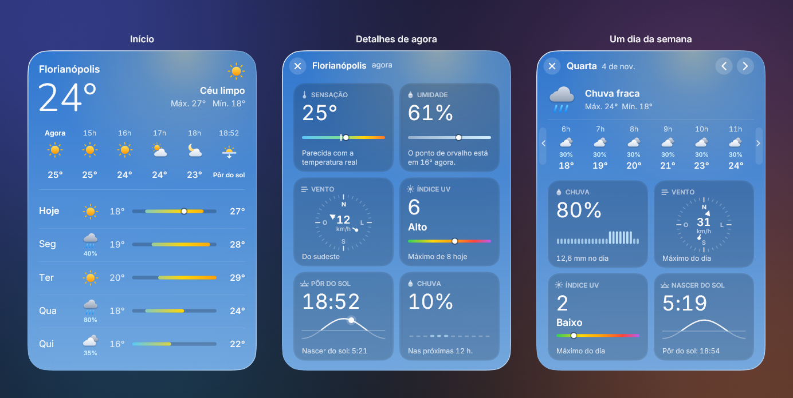
</p>

### Sistema

CPU, memória e disco em três anéis, com a porcentagem e quanto está em uso. Clique num anel e o
widget vira para mostrar os apps que mais usam aquele recurso (no disco, as unidades). No grande,
aparecem os 5 primeiros, com ícone, junto com a rede e há quanto tempo o PC está ligado.

<p align="center">
  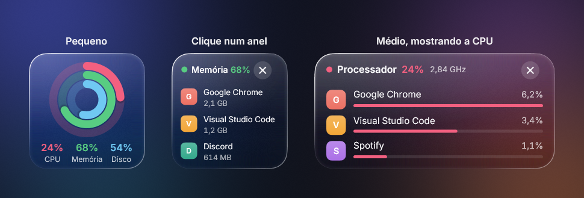
</p>

### Tocando agora

Acompanha o que estiver tocando no Windows (Spotify, YouTube no navegador e outros). O fundo
ganha as cores da capa e muda junto quando a música troca. No grande, há também o volume do app,
aleatório e repetir; clique na barra de progresso para pular. A roda do mouse em cima dele muda
o volume. Um clique e ele vira a [ilha dinâmica](#a-ilha-dinâmica).

<p align="center">
  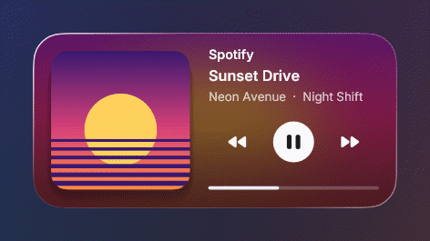
</p>

### GitHub

O mapa de contribuições do último ano, em quadrados que ocupam o cartão: quanto maior o widget,
mais semanas (no grande, o ano inteiro em três faixas). Passe o mouse num quadrado para ver o
dia. Se você usa o [GitHub CLI](https://cli.github.com/), chega um aviso quando alguém pede sua
revisão.

<p align="center">
  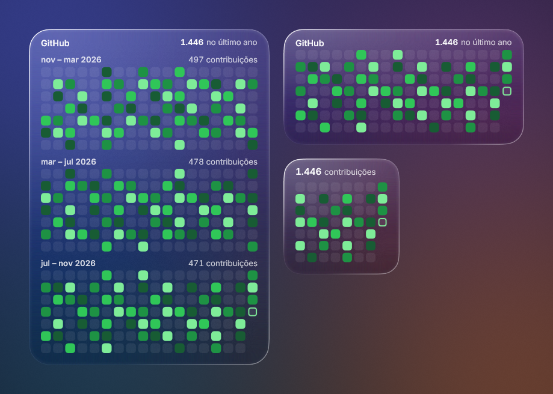
</p>

### Pomodoro

Um relógio com timer de foco e pausas. Conta os ciclos até a pausa longa, soma quanto você focou
no dia e começa ou pausa com um clique (ou pelo clique direito, onde também mudam as durações).
No último minuto, ele passa na frente de tudo na ilha.

<p align="center">
  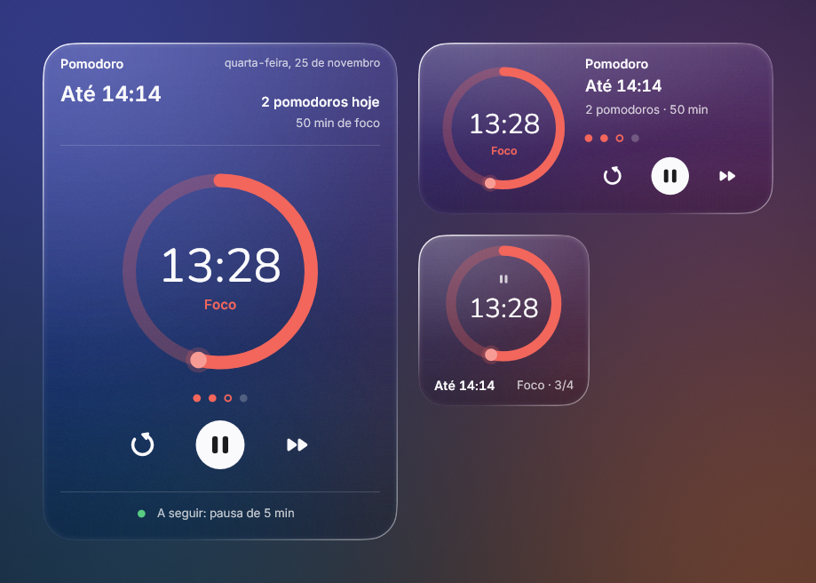
</p>

### Uso do Claude

Quanto da sessão de 5 horas e da semana do seu plano você já usou no
[Claude Code](https://code.claude.com), com quando cada medidor reinicia, os dias da semana em
que você mais usa e um aviso se, no ritmo de agora, a sessão acaba antes de reiniciar.

O Clawd, o caranguejo do Claude Code, acompanha tudo o que ele faz: programa num notebook enquanto
o Claude Code edita; vira Sherlock Holmes, de lupa e cachimbo, quando ele lê e procura no código;
olha longe de binóculo pesquisando na web; escreve numa prancheta no modo de planejamento; segura
uma ampulheta num comando demorado; leva a garra à testa quando um comando falha e comemora
quando passa; ganha ajudantes pequenininhos com os subagentes; e acena com um "!" quando o Claude
Code precisa de você. Parado, ouve música e, depois de muito tempo, cochila de gorro. Perto do
limite, sua; no limite, finca a plaquinha "VOLTO LOGO" e fica lendo até reiniciar. Em dezembro,
ganha gorro de Papai Noel e neve.

Um clique no Clawd e ele pula para cima da barra de tarefas, ao lado do relógio, onde continua
trabalhando por cima das janelas, com um balão dizendo o que o Claude Code faz agora ("Editando
claude.rs", "Rodando cargo test · 1:12"). Para compartilhar a tela, dá para mostrar só a ação,
sem os nomes de arquivos e comandos.

<p align="center">
  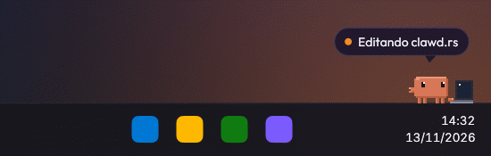
</p>

<p align="center">
  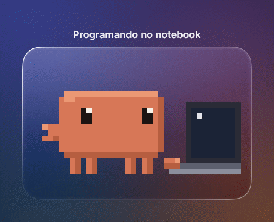
</p>

<details>
<summary><b>Como o widget se conecta ao Claude Code</b></summary>

<br>

Os números vêm do próprio Claude Code: ao clicar em **Conectar**, o widget vira a linha de status
dele (só se ainda não houver outra; uma cópia das configurações do Claude Code fica em
`settings.json.antes-do-widgets`) e ganha um aviso (`hooks.Notification`) de quando o Claude Code
precisa de você. Desconectar tira os dois, sem mexer em outros avisos que você tenha. Funciona
nos planos Pro e Max, a partir da primeira resposta de cada conversa.

</details>

<p align="center">
  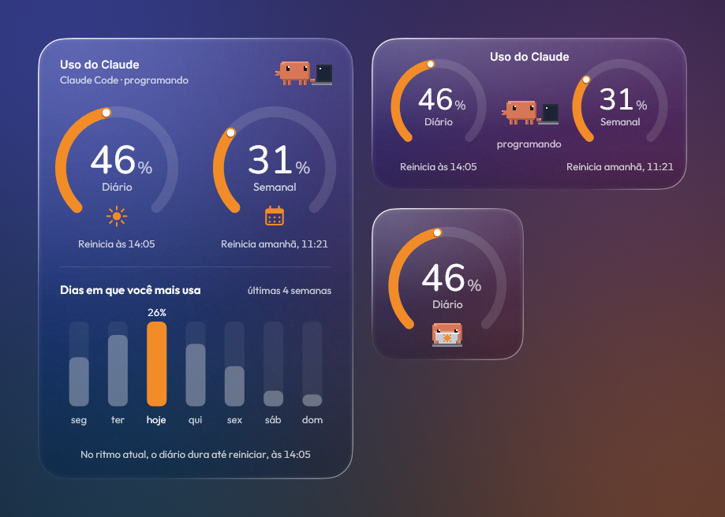
</p>

### Bateria

A bateria do notebook e a dos dispositivos conectados: fones, mouses, teclados e controles. O
anel do notebook mostra a carga e quanto falta para acabar (ou para encher, na tomada). O grande
mostra também a saúde da bateria (a capacidade de agora contra a de fábrica), os ciclos de carga
e as últimas 24 horas, com os períodos na tomada em verde. Um aviso chega quando um aparelho
passa de 15%. Num PC de mesa, sem bateria, o widget vira só a lista de dispositivos.

Um aparelho que conecta aparece na hora, com o ícone entrando num "pop" e o arco enchendo até a
carga. As animações tocam só quando importam: ao ligar na tomada, quando a carga muda e na carga
completa.

<details>
<summary><b>Quais aparelhos aparecem</b></summary>

<br>

Os que informam a bateria ao Windows (a maioria dos fones e dos mouses e teclados Bluetooth). Os
que usam um receptor USB próprio só mostram a carga no app do fabricante.

</details>

## A ilha dinâmica

Uma pílula preta na barra de tarefas, à esquerda do botão Iniciar, que mostra o que importa
agora, como a ilha dinâmica do iPhone. Ela nasce como uma gota que acende e estica, com o mouse em
cima mostra mais, com um clique abre inteira, e some encolhendo numa gota quando não tem mais nada
a dizer. Em jogo ou vídeo em tela cheia, ela se esconde.

Arraste para qualquer lugar: perto da barra ou do alto e do meio da tela, ela encaixa lá; no
clique direito, **Na barra de tarefas** a leva de volta.

### A música

Clique no Tocando agora (fora dos botões) e ele vira a ilha: parada, mostra a capa e ondas que
seguem o som; com o mouse em cima, a música, tocar e avançar; aberta, a barra de progresso. A roda
do mouse muda o volume. **Voltar para a área de trabalho** devolve o widget ao lugar dele; se nada
tocar por 5 minutos, ele volta sozinho.

<p align="center">
  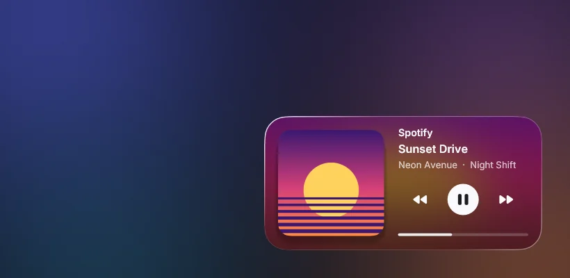
</p>

### Os widgets passam por ela

Quando têm algo a dizer: o Pomodoro correndo, a CPU alta no Sistema, um pedido de revisão no
GitHub, a bateria fraca (ou "Carregando · cheia em 1 h 10" ao ligar na tomada) e o Tempo avisando
de chuva chegando, trovoada ou uma mudança forte de temperatura amanhã. Com vários ao mesmo tempo,
o mais importante fica na pílula e os outros esperam em bolhas ao lado. Cada widget tem o
interruptor **Mostrar na ilha** nas configurações.

### O mundo lá fora

A ilha também avisa do que acontece fora do PC, cada coisa na hora dela:

| | Quando aparece |
|---|---|
| **Bom dia, boa tarde, boa noite** | Na primeira vez que você usa o PC em cada período, com o tempo e as cotações se alternando (e, de noite, a lua cheia e a ISS) |
| **Pôr do sol** | 15 minutos antes, com o céu previsto para a hora |
| **Lua cheia e eclipses** | Na noite de lua cheia, com a hora em que ela nasce, e nos eclipses da Lua que dá para ver daqui |
| **Estação Espacial** | 5 minutos antes de ela passar visível no seu céu (de noite e sem nuvens), e enquanto passa, com a direção para olhar |
| **Cotação** | Quando o dólar varia mais de 1,5% no dia, ou o bitcoin mais de 5% |
| **Fim do expediente** | Uma contagem na última hora, de segunda a sexta, e um "bom descanso" no fim (o horário você escolhe) |

O sol, a lua, os eclipses e as passagens da ISS são calculados no seu PC, para a cidade do widget
Tempo. As saudações esperam você estar no PC, fora de tela cheia e fora de um foco do Pomodoro.
Cada um liga e desliga em Configurações → Geral.

<p align="center">
  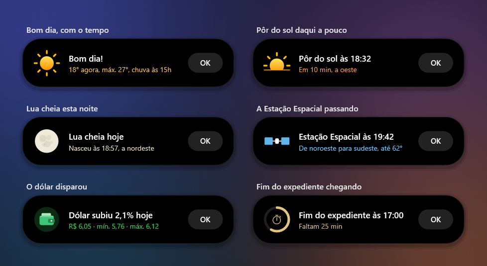
</p>

### Sempre na barra

Sem nada acontecendo, a ilha fica na barra de tarefas mostrando o que você escolher. Com mais de
um escolhido, eles se alternam a cada 7 segundos:

- **Relógio:** a hora e a data; aberta, quanto falta para o fim do expediente.
- **Linha do dia:** o dia numa régua, com o sol andando até o pôr e o fim do expediente marcado.
- **Próximo acontecimento:** quanto falta para o fim do expediente, o pôr do sol, a lua cheia ou a ISS.
- **Tempo agora:** a temperatura e a próxima chuva; aberta, as próximas 6 horas.
- **Cotações:** o dólar e o bitcoin, com a variação e o gráfico do dia.
- **Foco do dia:** quantos Pomodoros você fez hoje, com um botão para começar o próximo.
- **Última música:** a música que tocou por último, pronta para voltar com um clique.
- **Só uma gota:** fechada, a ilha é só um ponto que respira na cor da hora do dia. Um clique a
  abre no tamanho normal; outro, inteira.

Qualquer aviso de verdade passa na frente, e o repouso volta quando ele acaba. Com o PC parado há
5 minutos, ela vira uma gota apagada. Parada, só redesenha quando algo muda (o minuto, a troca, os
dados), então quase não gasta nada. Escolha o que ela mostra em Configurações → Geral → **A ilha
em repouso**, ou no clique direito dela.

<p align="center">
  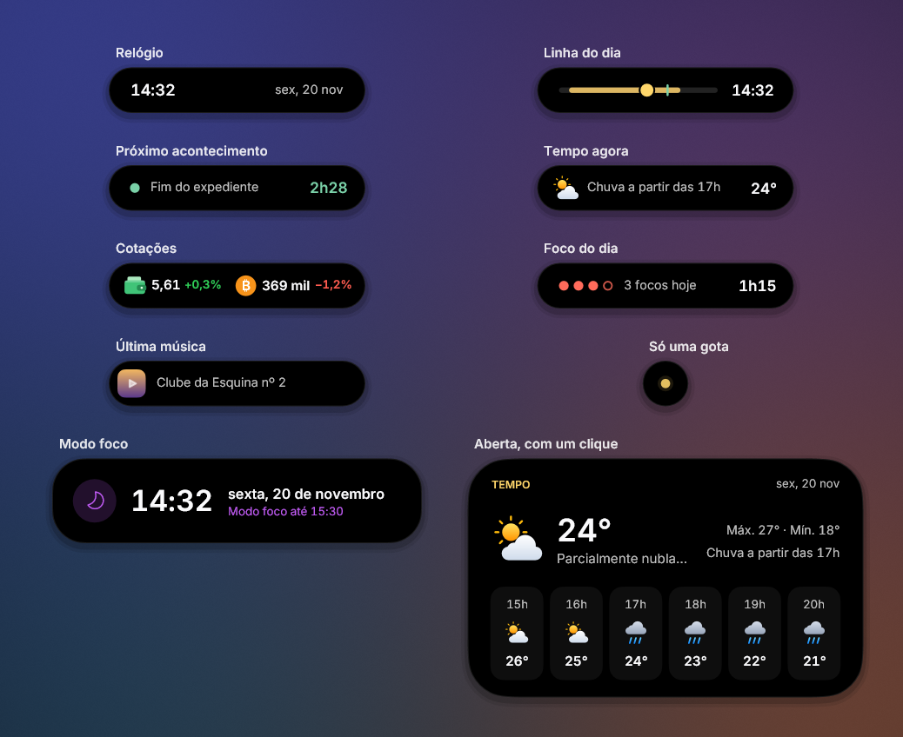
</p>

### Modo foco

Para trabalhar sem distração: os widgets somem da área de trabalho e a ilha fica só com a hora, o
dia e o ícone do foco, sem avisos nem rodízio. Ligue por 30 minutos, 1 hora, 2 horas ou até
desligar, no clique direito da ilha, de um widget ou do ícone da bandeja, ou em Configurações →
Geral → **Modo foco**. Para sair, abra a ilha e clique em **Sair do modo foco**.

## Do tamanho que você quiser

Clique no botão que aparece no canto, ou dê dois cliques no widget. O pequeno é um quadrado, o
médio tem a largura de dois pequenos lado a lado e o grande tem espaço para as listas. Na troca,
o que aparece nos dois tamanhos anda até o lugar novo, e os vizinhos se ajeitam sozinhos.

Para mover, é só arrastar: eles se encaixam uns nos outros e nas bordas da tela (segure `Alt`
para soltar livre). **Organizar widgets** arruma cada monitor em colunas a partir da direita,
como no iPhone, sem nenhum encostar em outro, na ilha ou fora da tela.

**Pilhas.** Solte um widget no meio de outro e os dois viram uma pilha, como no iPhone: ocupam o
lugar de um só e a roda do mouse troca entre eles. Para desfazer, clique direito → **Tirar da
pilha**.

<table>
  <tr>
    <td width="34%" align="center">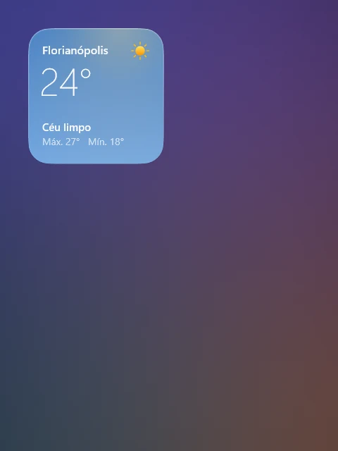</td>
    <td align="center">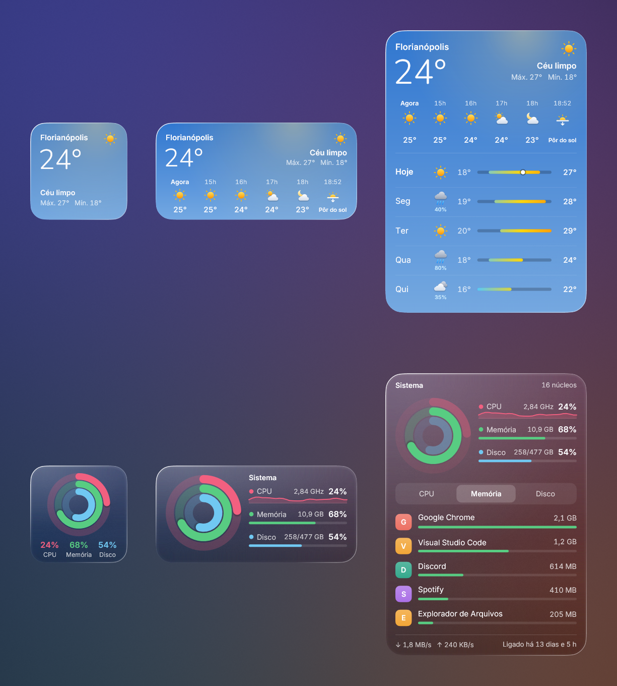</td>
  </tr>
</table>

## Configurações

Tudo muda na hora, sem botão de salvar: o quanto o vidro desfoca e escurece (com uma prévia ao
vivo), quais widgets aparecem, as opções de cada um, a ilha e quais avisos você quer receber.
Na primeira vez, umas boas-vindas rápidas ajudam a escolher os widgets e a cidade do clima.

<table>
  <tr>
    <td>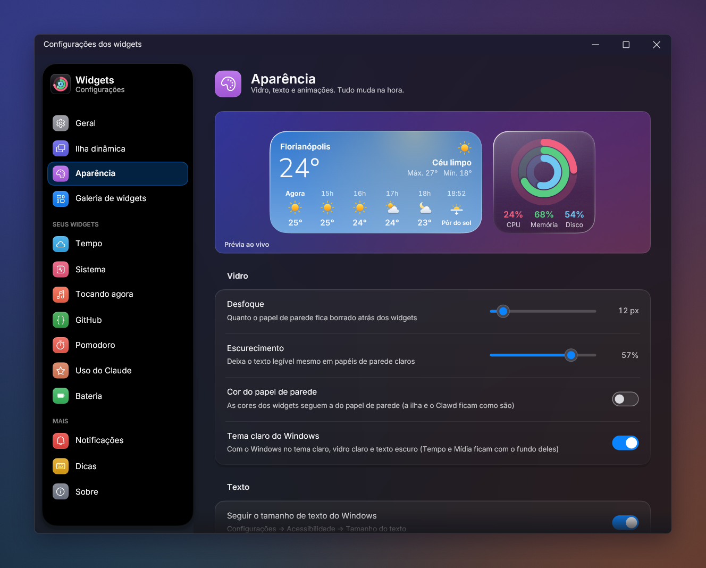</td>
    <td>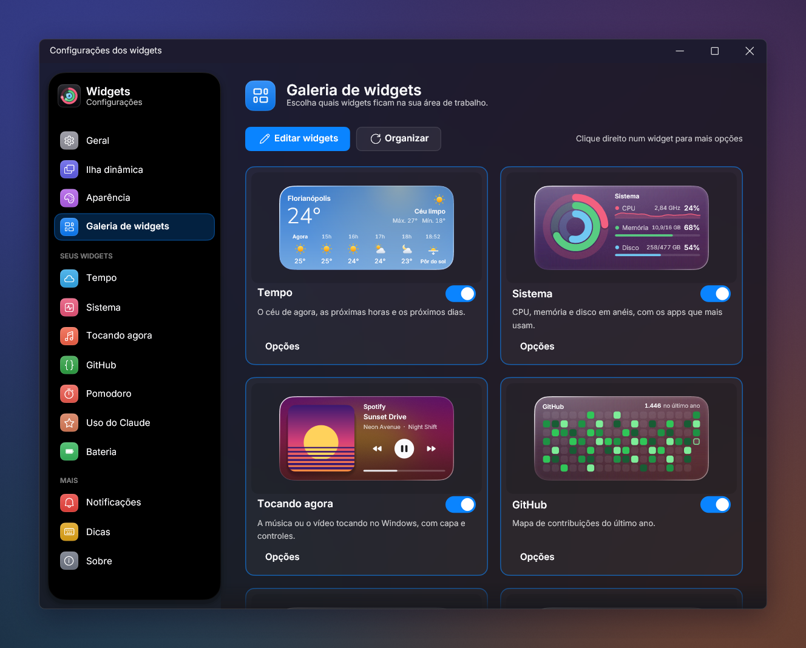</td>
  </tr>
</table>

<p align="center">
  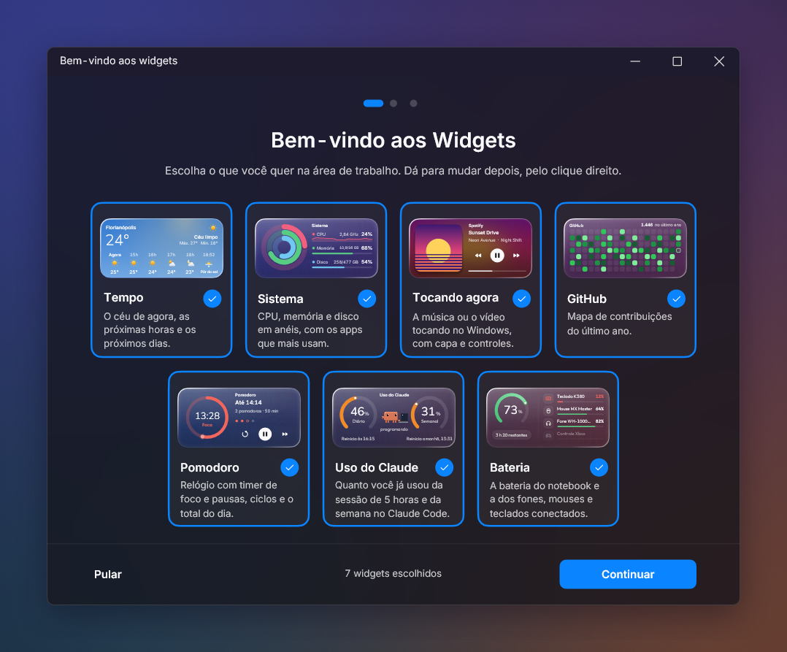
</p>

### Tudo no clique direito

O app não usa atalhos de teclado globais, para não roubar combinações de outros programas (nem o
AltGr do teclado ABNT2). Tudo fica no menu do clique direito, num widget, na ilha ou no ícone da
bandeja:

| | |
|---|---|
| Organizar widgets | Arruma cada monitor em colunas a partir da direita |
| Mostrar na frente | Traz os widgets para a frente das janelas |
| Modo edição | Fecha, redimensiona e move tudo de uma vez (e tem "Desfazer") |
| Modo foco | Esconde os widgets por 30 min, 1 h, 2 h ou até você desligar; a ilha fica só com a hora |
| Layouts | Guarda e troca arrumações dos widgets |
| Na ilha | O que mostrar em repouso, a gota, o modo foco e levar de volta à barra |
| No Pomodoro | Começar, pausar, pular de fase e mudar as durações |
| No Uso do Claude | Conectar ou desconectar do Claude Code e ver o uso no claude.ai |

### Com mais de um monitor

Os widgets lembram onde ficam em cada combinação de telas. Se você tira o notebook do monitor
externo, eles vão para a tela do notebook sem ficar um em cima do outro; quando você conecta de
novo, cada um volta para onde estava. Um jogo em tela cheia pausa só os widgets daquele monitor,
e cada tela usa o próprio papel de parede no vidro.

### Desenhar pela CPU ou pela placa de vídeo

Os widgets chegam à tela de dois jeitos. A escolha fica em Configurações → Geral → **Desenhar
pela placa de vídeo** e vale ao abrir o app de novo.

- **Pela CPU (o padrão):** cada quadro é montado em memória e copiado para uma janela
  transparente do Windows. Funciona em qualquer PC.
- **Pela placa de vídeo (experimental):** o quadro é desenhado direto na placa de vídeo e
  mostrado pela DirectComposition do Windows. As animações contínuas (o Clawd, a neve do Natal, a
  chuva do Tempo) gastam uns 25% menos CPU, em troca de uns 55 MB a mais de memória. Se a placa
  for reiniciada (o PC dormiu, o driver atualizou), os widgets se refazem sozinhos.

Na dúvida, ligue a placa de vídeo se o Clawd ou o Tempo vivem animando, principalmente na
bateria; deixe pela CPU num PC antigo, ou se algum cartão aparecer preto ou fora do lugar (e
conte para a gente numa issue).

## Quanto pesa no PC

Pouco. Os widgets só se redesenham quando algo muda (o relógio, uma música nova, um número do
sistema), e um jogo ou vídeo em tela cheia pausa os widgets daquele monitor.

Medido num notebook com Intel Core 5 120U (10 núcleos, 12 threads), com sete widgets abertos no
tamanho pequeno, num caso pesado: o Claude Code trabalhando, o tema de Natal ligado (a neve
caindo o tempo todo), o Pomodoro contando e o equalizador do Tocando agora animando. Quatro rodadas
de um minuto em cada jeito de desenhar, com a mediana:

| Desenho | CPU de um núcleo | CPU do processador inteiro | Memória |
|---|---|---|---|
| Pela CPU (o padrão) | ~6,5% | 0,55% | ~47 MB |
| Pela placa de vídeo | ~5% | 0,4% | ~105 MB |

<details>
<summary><b>Mais detalhes da medição</b></summary>

<br>

O número muda com o que mais o PC está fazendo: entre as rodadas, pela CPU foi de 5,6% a 9,8% de
um núcleo, e pela placa de vídeo, de 4,3% a 6,1%. Nas situações mais calmas, a versão 3.12 media,
desenhando pela CPU: parado e sem música, ~4% de um núcleo (0,25% do processador inteiro); com
música tocando, ~6,5% (0,4%).

A memória é a memória privada do processo, que fica perto da coluna Memória do Gerenciador de
Tarefas. Em processadores com menos núcleos, a porcentagem do processador inteiro sobe um pouco,
mas o trabalho é o mesmo. Para conferir na sua máquina, abra o Gerenciador de Tarefas e procure
por **Widgets**.

</details>

## Privacidade

O app não tem conta, telemetria nem anúncios. Ele só acessa a internet para buscar o que cada
widget mostra, e só quando o widget está ligado:

| O quê | Com quem conversa | O que envia |
|---|---|---|
| Tempo | [Open-Meteo](https://open-meteo.com) | O nome da cidade (para achá-la) e as coordenadas dela |
| GitHub | api.github.com | O seu usuário do GitHub |
| Tocando agora | youtube.com | Título e canal do vídeo, só para buscar a capa em alta resolução quando ele toca no navegador. Dá para desligar em **Configurações → Tocando agora → Capa em alta do YouTube** |
| Cotação (aviso, saudações e ilha) | [AwesomeAPI](https://docs.awesomeapi.com.br) | Nada: só pede o preço do dólar e do bitcoin |
| Estação Espacial | [CelesTrak](https://celestrak.org) | Nada: baixa a órbita da ISS a cada 12 horas; as passagens são calculadas no seu PC |
| Uso do Claude | Ninguém | Os números chegam do Claude Code, na sua máquina |
| Sistema, Pomodoro, Bateria, pôr do sol, lua, modo foco | Ninguém | |
| Atualizações | api.github.com | Nada além do pedido da versão mais recente, a cada 6 horas. Dá para desligar em **Configurações → Sobre → Procurar atualizações sozinho** |

Fora disso, o app não envia nenhuma informação para outros sistemas em rede, a não ser quando
você pede (abrir um link, por exemplo). O instalador e o `install.ps1` mostram este resumo antes
de instalar.

As configurações ficam em `%APPDATA%\Widgets` (o `config.json` dá para ler e editar à mão).

## Perguntas frequentes

<details>
<summary><b>É de graça mesmo?</b></summary>

<br>

Sim, e sem pegadinha: sem conta, sem versão paga, sem anúncios. O código é aberto, sob a licença
MIT.

</details>

<details>
<summary><b>Vai deixar o meu PC lento?</b></summary>

<br>

Não. Com sete widgets abertos e animando, o app usa menos de 1% do processador e uns 50 MB de
memória (veja [Quanto pesa no PC](#quanto-pesa-no-pc)). Parados, os widgets e a ilha só redesenham
quando algo muda, e jogos e vídeos em tela cheia pausam tudo.

</details>

<details>
<summary><b>Por que o Windows avisou que "protegeu o computador"?</b></summary>

<br>

Porque as versões ainda saem sem assinatura digital, e o Windows desconfia de todo programa novo
que pouca gente baixou. Veja [o passo a passo](#o-aviso-do-windows) e
[Por que dá para confiar](#por-que-dá-para-confiar).

</details>

<details>
<summary><b>Precisa de internet?</b></summary>

<br>

Só para o que vem de fora: o clima, o GitHub, as cotações e a órbita da ISS. O resto (sistema,
música, Pomodoro, bateria, uso do Claude, sol, lua e modo foco) funciona offline.

</details>

<details>
<summary><b>Como desinstalo?</b></summary>

<br>

Configurações do Windows → Aplicativos → Widgets → Desinstalar. As suas configurações ficam em
`%APPDATA%\Widgets`, que você pode apagar se quiser. Se conectou o Uso do Claude, desconecte antes
(no clique direito do widget) para devolver a linha de status do Claude Code.

</details>

<details>
<summary><b>Dá para usar só alguns widgets, ou só a ilha?</b></summary>

<br>

Dá. Cada widget liga e desliga na Galeria de widgets e tem o interruptor **Mostrar na ilha** nas
configurações dele; o mundo lá fora, a ilha em repouso e o modo foco ficam em Configurações →
Geral.

</details>

## Code signing policy

Free code signing provided by [SignPath.io](https://about.signpath.io/), certificate by
[SignPath Foundation](https://signpath.org/).

- **Committers and reviewers:** [lucasschn1](https://github.com/lucasschn1)
- **Approvers:** [lucasschn1](https://github.com/lucasschn1)

> **Situação:** o pedido de assinatura à SignPath Foundation ainda está em andamento. Até ele ser
> aprovado, as versões saem **sem** assinatura digital (veja
> [O Windows disse que "protegeu o computador"](#o-aviso-do-windows)).

Em português: cada versão é compilada pelo
[GitHub Actions](https://github.com/lucasschn1/Widgets/actions/workflows/release.yml) a partir do
código público da tag, depois de passar nos testes. O `Widgets.exe` e o instalador só são
assinados depois que um aprovador confere e aprova o pedido de assinatura daquela versão. Só é
assinado o que é compilado deste repositório. Sobre os dados, veja [Privacidade](#privacidade):
o app não envia nenhuma informação para outros sistemas em rede, a não ser nos casos descritos lá
ou quando você pede.

---

## Para quem quer mexer no código

Fork, ideia de widget novo ou correção: tudo é bem-vindo. Abra uma
[issue](https://github.com/lucasschn1/Widgets/issues) para conversar antes de algo grande, ou
mande direto um pull request.

O app é escrito em [Rust](https://www.rust-lang.org/) e conversa direto com o Windows: Direct2D
e DirectWrite para desenhar, WIC para as imagens e WinRT para saber o que está tocando. Não há
framework de interface: cada widget desenha o próprio conteúdo num `Canvas`, e o resto (vidro,
arrastar, encaixar, tamanhos, menus) é comum a todos.

### Compilar

Instale o Rust pelo [rustup](https://rustup.rs) (ele oferece as ferramentas de compilação do
Visual Studio, se faltarem) e rode:

```powershell
git clone https://github.com/lucasschn1/Widgets
cd Widgets
cargo run              # versão de teste
cargo test             # os testes
cargo build --release  # o Widgets.exe final, em target\release
```

A versão de teste pode ficar aberta junto com a instalada: ela usa outra pasta de opções
(`%APPDATA%\Widgets-dev`), outro ícone na bandeja e outra entrada em "iniciar com o Windows".

### Testes

Todo pull request passa pelos testes no GitHub Actions ([CI](.github/workflows/ci.yml)), e a
`main` só recebe o PR com eles verdes.

```powershell
cargo test --release   # unidade e integração dentro do app
cargo test             # tudo, incluindo o Widgets.exe de verdade (o que o CI roda)
```

- **Unidade**, em cada módulo: opções e migrações, versões, a linha de status do Claude, o
  encaixe entre monitores, a previsão do tempo, o sol, a lua e a órbita da ISS (conferidos com os
  eclipses da NASA)...
- **Os widgets inteiros** ([`src/testes/mod.rs`](src/testes/mod.rs)): cada widget, em cada tamanho e em
  cada estado, desenhando e respondendo ao mouse em toda a área do cartão; e cada fonte da ilha,
  em cada forma.
- **As janelas**: todas as páginas das configurações e os passos das boas-vindas.
- **O executável** ([`tests/binario.rs`](tests/binario.rs)): a linha de status do Claude Code e
  o app abrindo do zero, sempre num perfil temporário (sem tocar nas suas opções).

### Ver a sua branch nos widgets instalados

`dev\aplicar.ps1` compila a pasta atual (com as alterações ainda não commitadas), roda os
testes, troca o `Widgets.exe` instalado e confere se o app ficou aberto. Se ele fechar sozinho,
volta o anterior. A versão lançada fica guardada:

```powershell
powershell -File dev\aplicar.ps1          # aplica a branch atual
powershell -File dev\aplicar.ps1 -Voltar  # volta para a versão lançada
```

Com o [Claude Code](https://code.claude.com), o [`CLAUDE.md`](CLAUDE.md) descreve o fluxo
completo: cada alteração numa branch, aplicada nos widgets ao fim de cada resposta por um hook
(`dev\aplicar.ps1 -Auto`), e commit e PR só depois de conferir.

<details>
<summary><b>Como o código está organizado</b></summary>

```
install.ps1           instalador de uma linha (baixa o último Release)
dev/aplicar.ps1       aplica a branch atual nos widgets instalados (e volta a versão lançada)
tests/                testes com o Widgets.exe de verdade
packaging/            build.ps1 (Widgets.exe e .zip), o instalador do Inno Setup, o resumo de
                      privacidade e readme_anim.py (junta os quadros das animações do README)
res/                  ícone, fontes e manifesto embutidos no Widgets.exe (pelo build.rs)
src/
  main.rs             inicia o app e roda o laço de mensagens
  app/                o coordenador: liga os widgets, as janelas, os menus e os modos
    mod.rs            arraste, encaixe, menus, avisos, modo foco e modo edição
    island.rs         a ilha dinâmica: formas, animações, bolhas, repouso e modo foco
    panels.rs         as configurações, as perguntas e as boas-vindas
    screens.rs        vários monitores: o lugar dos widgets em cada combinação de telas
    stack.rs          as pilhas de widgets
    perch.rs          o Clawd em cima da barra de tarefas
    entrances.rs      quando os widgets entram na tela
  card/               o cartão de cada widget na área de trabalho
    mod.rs            tamanhos, botão de tamanho, destaque, carregando e animações
    morph.rs          a troca de tamanho, peça por peça
    arrange.rs        o "Organizar widgets" (colunas a partir da direita)
    entrance.rs       a animação de entrada
    backdrop.rs       o vidro: o papel de parede desfocado atrás dos cartões
  widgets/            o que cada widget mostra (o trait `Kind` fica no mod.rs)
    tempo.rs, system.rs, media.rs, github.rs, pomodoro.rs, claude.rs, battery.rs...
    island_ui.rs      as peças que os widgets usam para se desenhar na ilha
    outside/          o mundo lá fora (saudações, sol, lua, ISS, cotação, expediente) e a
                      ilha em repouso
  ui/                 as janelas desenhadas
    panel.rs          o motor delas (controles e campos de texto)
    settings.rs       as páginas das configurações
    prompt.rs         as perguntas de vidro, as sugestões de cidade e as boas-vindas
    popup.rs          o menu de vidro e os avisos com "Desfazer"
    overlay.rs        guias de encaixe e dicas do mouse
    tray.rs           ícone na bandeja e notificações
    theme.rs          medidas, cores e ícones
  gfx/                o desenho
    mod.rs            Direct2D, DirectWrite e WIC (o Canvas)
    drawing.rs        formas e ícones reaproveitados
    imgops.rs         desfoque e recortes feitos à mão
    output.rs, gpu/   como o quadro chega à tela (pela CPU ou pela placa de vídeo)
    meter.rs          o medidor de desempenho (WIDGETS_PERF=1)
    wallcolor.rs      os widgets na cor do papel de parede
  platform/           a conversa com o Windows
    win.rs            o resto da API do Windows (monitores, barra de tarefas, relógio...)
    events.rs         janelas do Windows e a fila de eventos
    sysinfo.rs        CPU, memória, disco, rede e processos
    battery.rs        a bateria do notebook e dos dispositivos
    startup.rs        iniciar com o Windows
    updates.rs        procurar e instalar versões novas
  data/               opções, estado e cálculos (sem tela)
    config.rs         lê e grava as opções (config.json e cache.json), com os valores padrão
    shared.rs         o estado que todos os widgets consultam
    astro.rs          o sol, a lua, os eclipses e a órbita da ISS
    claude_usage.rs   o uso do Claude Code: a linha de status e o arquivo com os números
    claude_history.rs os dias da semana em que você mais usa o Claude Code
    util.rs           datas, números e downloads
  testes/             só nos testes
    mod.rs            todos os widgets, tamanhos e estados
    perf.rs           a bancada de desempenho
    readme_images.rs  gera as imagens do README
```

</details>

### Criando um widget novo

Todo widget é um tipo que implementa o trait `Kind` (em `src/widgets/mod.rs`). Só `key`,
`title` e `draw` são obrigatórios; o resto (`hit` e `act` para cliques, `tick` para atualizar,
`menu` para o clique direito, `island_item` e `island_draw` para a ilha...) tem um padrão que
não faz nada. O tamanho do cartão não é escolha do widget: os três tamanhos são iguais para todos
(`Layout::of(mode)`), e o widget só desenha dentro deles.

1. **Crie o arquivo** `src/widgets/meu.rs`. Um ponto de partida:

   ```rust
   use super::{Env, Kind, Layout, Mode};
   use crate::gfx::{Anchor, Canvas, Face};
   use crate::theme::*;

   pub struct Meu;

   impl Kind for Meu {
       fn key(&self) -> &'static str {
           "meu"
       }
       fn title(&self) -> &'static str {
           "Meu widget"
       }
       fn draw(&self, c: &mut Canvas, mode: Mode, _env: &Env) {
           let l = Layout::of(mode);
           c.text(l.w / 2.0, l.h / 2.0, "Olá!", Face::Semibold, 24.0, WHITE, Anchor::MM, None);
       }
   }
   ```

2. **Registre** em `src/widgets/mod.rs`: `pub mod meu;`, a chave em `KEYS`, e uma linha em
   `create`, `title`, `description` e `icon_name` (o ícone vem de `theme::icon`, com os códigos
   da fonte Segoe Fluent Icons). Em `FIRST_LAYOUT`, escolha a coluna em que ele aparece na
   primeira vez; em `ADDED_LATER`, se ele não deve surgir sozinho para quem já usa o app.
3. **Opções:** as do widget ficam na seção dele do `config.json` (`env.wcfg()` para ler). Para
   ter uma página nas configurações, acrescente um caso em `ui/settings.rs` (veja os de `"tempo"` e
   `"github"`) e em `size_id`.
4. **Dados de fora** (internet, sistema) nunca no `draw`: busque numa thread e receba no `tick`,
   como fazem `tempo.rs` e `github.rs`. O `draw` roda a cada quadro e precisa ser rápido.
5. **Testes:** acrescente o widget (e os estados dele) em `cases()` de `src/testes/mod.rs`; o teste
   `every_widget_has_its_registry_entries` avisa se faltou alguma lista do passo 2.
6. **Veja no app:** `cargo run` (ou `dev\aplicar.ps1`), e mostre o widget na Galeria de widgets.

Uma opção geral nova (que vale para o app todo) vai em `data/config.rs`, com o valor padrão. As
configurações não têm botão de salvar: `set_setting` grava e aplica na hora.

### As imagens do README

São desenhadas pelo próprio código, com dados de exemplo, então ficam sempre iguais ao app:

```powershell
cargo test --release testes::readme_images::readme -- --ignored --exact   # imagens paradas, em docs\images
cargo test --release island_feeds -- --ignored                            # só as imagens da ilha nova
python packaging\readme_anim.py                                   # GIFs e animações (precisa do Pillow)
```

### Fazendo um fork com releases próprios

O app procura atualizações no repositório de origem. No seu fork, troque `lucasschn1/Widgets`
pelo seu repositório em `src/platform/updates.rs`, `install.ps1` e `packaging/Widgets.iss`, e o nome do
autor em `build.rs`. Assim os seus usuários recebem as suas versões.

### Lançando uma versão

1. Mude `version` no `Cargo.toml` numa branch e faça o PR (a `main` só recebe código por PR).
2. Depois do merge, crie a tag na `main`: `git switch main`, `git pull`, `git tag v3.21.0` e
   `git push origin v3.21.0`.

O GitHub Actions roda os testes de novo, compila o `Widgets.exe`, gera o `.zip` e o instalador e
publica o Release. Com a assinatura configurada, ele para duas vezes esperando você aprovar o
pedido na SignPath (o do `Widgets.exe` e o do instalador); veja
[docs/assinatura.md](docs/assinatura.md). Quem já tem o app instalado recebe o aviso de
atualização. Para gerar o `.zip` na sua máquina, rode `packaging\build.ps1`.

<details>
<summary><b>A versão 2, em Python</b></summary>

<br>

Até a versão 2.0 o app era em Python, com Pillow e Tkinter. Ela continua disponível no
[Release 2.0.0](https://github.com/lucasschn1/Widgets/releases/tag/v2.0.0) e o código, na tag
[`v2.0.0`](https://github.com/lucasschn1/Widgets/tree/v2.0.0). Com a reescrita em Rust, o
download caiu de 22 MB para cerca de 1,5 MB, e o app passou a usar mais ou menos metade da
memória.

</details>

## Licença

[MIT](LICENSE): use, modifique e distribua à vontade, inclusive em forks e projetos comerciais,
mantendo o aviso de copyright. A fonte Outfit, embutida no app, tem a licença dela
([SIL Open Font License](res/fonts/OFL.txt)).
