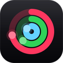
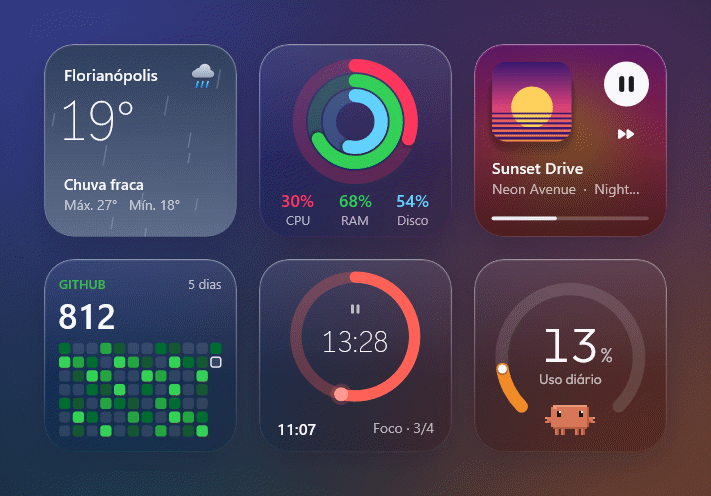
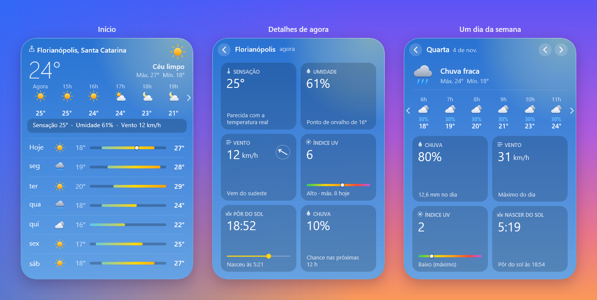
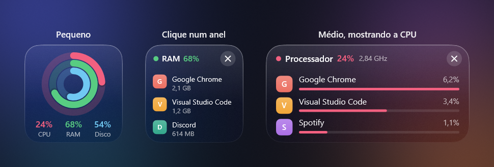
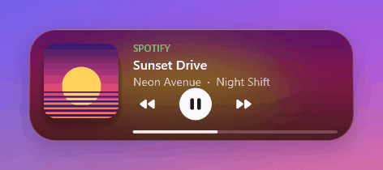
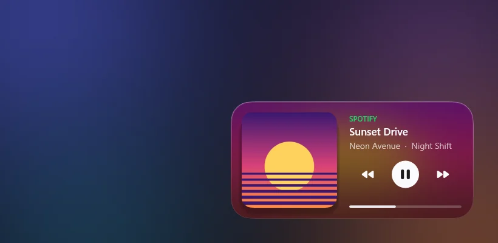
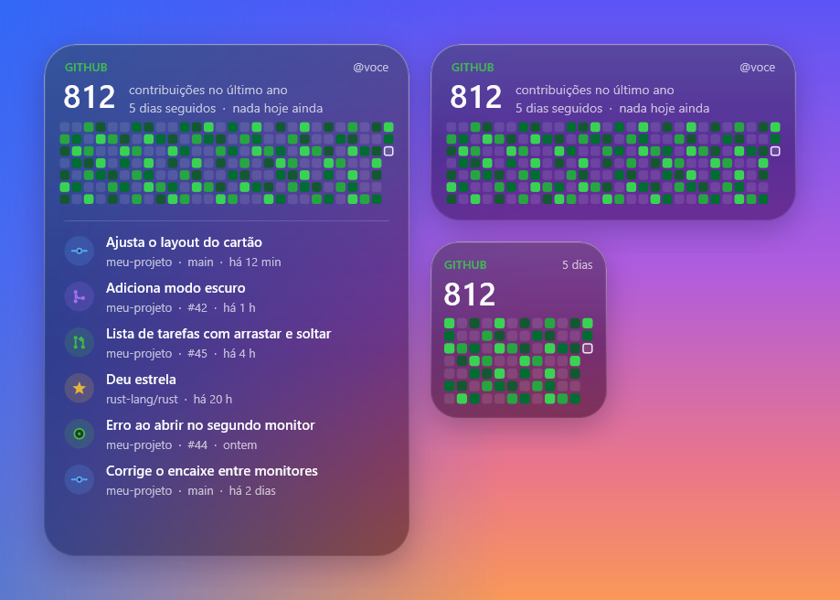
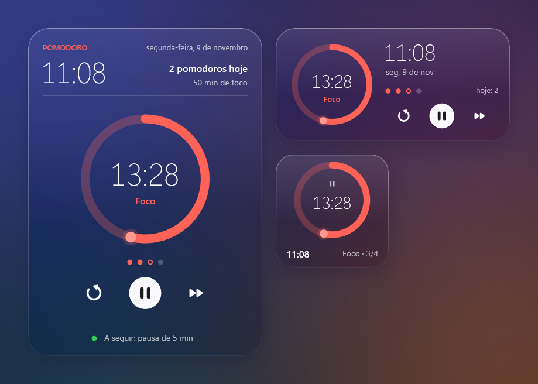
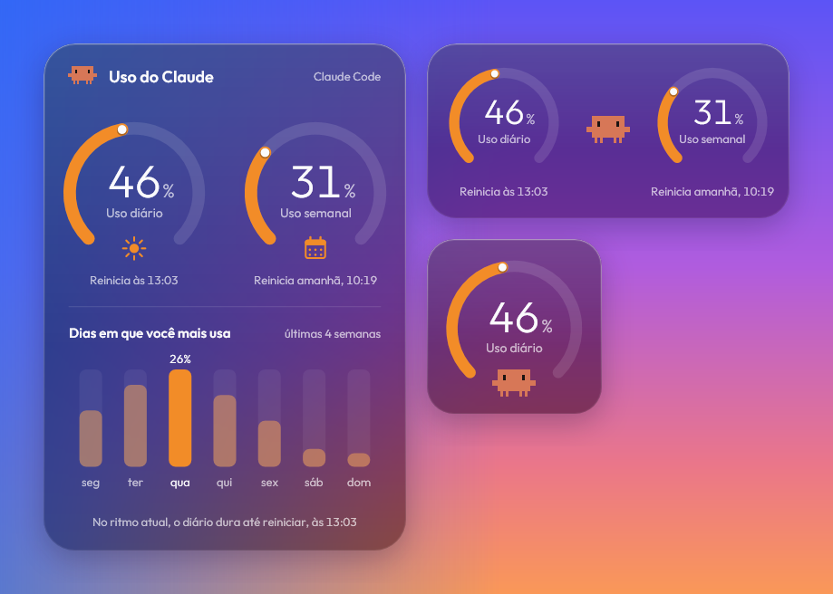

<p align="center">
  
</p>

<h1 align="center">Widgets</h1>

<p align="center">
  <b>Widgets de vidro para a área de trabalho do Windows.</b><br>
  Clima, sistema, a música que está tocando, seu GitHub, um Pomodoro e o uso do Claude,
  presos ao papel de parede.
</p>

<p align="center">
  <a href="https://github.com/lucasschn1/Widgets/releases/latest"></a>
  
  <a href="https://github.com/lucasschn1/Widgets/actions/workflows/release.yml"></a>
  
  <a href="LICENSE"></a>
  <a href="https://github.com/lucasschn1/Widgets/releases"></a>
</p>

<p align="center">
  
</p>

<p align="center">
  <a href="https://github.com/lucasschn1/Widgets/releases/latest/download/Widgets-Setup.exe"><b>⬇ Baixar o instalador</b></a>
  &nbsp;·&nbsp;
  <a href="#instalar">Instalar pelo terminal</a>
  &nbsp;·&nbsp;
  <a href="#os-widgets">Ver os widgets</a>
  &nbsp;·&nbsp;
  <a href="#privacidade">Privacidade</a>
  &nbsp;·&nbsp;
  <a href="#para-quem-quer-mexer-no-código">Mexer no código</a>
</p>

Eles ficam atrás das janelas, e o fundo de cada um é o próprio papel de parede desfocado,
como um vidro fosco. Quando o mouse sai de cima, ficam um pouco mais transparentes, para não
roubar a atenção. O app inteiro é um único `Widgets.exe` de 3,5 MB (download de 1,5 MB), abre na hora e usa pouca
memória.

## Instalar

**Pelo instalador:** baixe o **[Widgets-Setup.exe](https://github.com/lucasschn1/Widgets/releases/latest/download/Widgets-Setup.exe)**
e siga os passos.

**Pelo terminal:** abra o **PowerShell** e cole:

```powershell
irm https://raw.githubusercontent.com/lucasschn1/Widgets/main/install.ps1 | iex
```

Nos dois casos não precisa ser administrador: o app vai para `%LOCALAPPDATA%\Programs\Widgets`,
ganha um atalho no Menu Iniciar e aparece em Configurações → Aplicativos, por onde também se
desinstala. Quando sai uma versão nova, o próprio app avisa e atualiza com um clique, sem perder
as suas configurações.

| | |
|---|---|
| **Sistema** | Windows 10 ou 11, 64 bits |
| **Tamanho** | 3,5 MB instalado (um `.exe` só, sem dependências) |
| **Consumo** | Uns 40 MB de memória e pouca CPU (veja [quanto pesa no PC](#quanto-pesa-no-pc)) |
| **Permissões** | Nenhuma de administrador; tudo fica na sua pasta de usuário |
| **Desinstalar** | Configurações → Aplicativos → Widgets |

<details>
<summary><b>O Windows disse que "protegeu o computador" (ou o navegador desconfiou do download)</b></summary>

<br>

Esses avisos aparecem porque as versões ainda saem **sem assinatura digital** (o pedido está em
andamento; veja a [política de assinatura](#code-signing-policy)). O Windows e os navegadores
desconfiam de todo programa novo, sem assinatura, que pouca gente baixou. O aviso não quer dizer
que encontraram algo no arquivo. Se quiser conferir antes, veja
[Por que dá para confiar](#por-que-dá-para-confiar).

**No navegador.** O Edge pode dizer que o arquivo "não é baixado com frequência". Clique nos três
pontinhos ao lado do aviso → **Manter** → **Mostrar mais** → **Manter assim mesmo**. O Chrome
também pode pedir que você confirme o download.

**Ao abrir o instalador.** Uma tela azul diz "O Windows protegeu o computador". É o SmartScreen:
clique em **Mais informações** e depois em **Executar assim mesmo**. Depois de instalado, o app
abre sem esse aviso.

**Pelo terminal, esses dois avisos não aparecem.** O `install.ps1` baixa a versão direto do
GitHub, sem passar pelo navegador.

**Se não houver o botão "Executar assim mesmo".** Nesse caso, quem barrou foi o
**Controle Inteligente de Aplicativos** do Windows 11 (veja se ele está ligado em Segurança do
Windows → Controle de aplicativos e navegador). Ele não abre exceção para um programa e costuma
barrar uma versão recém-lançada nos primeiros dias, até o Windows conhecer o arquivo. Espere
alguns dias e instale de novo; não precisa desligá-lo.

Quem já tem os widgets não corre risco de ficar sem eles. Antes de trocar a versão, o
`install.ps1` e o botão **Atualizar** do app conferem se o Windows deixa a nova abrir. Se não
deixar, os widgets continuam na versão que você tem, e o app avisa o motivo (a partir da
versão 3.11).

</details>

## Quanto pesa no PC

Pouco. Os widgets só se redesenham quando algo muda (o relógio, uma música nova, um número do
sistema), e um jogo ou vídeo em tela cheia pausa os widgets daquele monitor.

Medido na versão 3.12 num notebook com Ryzen 7 7730U (8 núcleos, 16 threads), com cinco widgets
na tela (Tempo, Sistema, Tocando agora, GitHub e Uso do Claude):

| Situação | CPU de um núcleo | CPU do processador inteiro |
|---|---|---|
| Parado, sem música tocando | ~4% | 0,25% |
| Com música tocando | ~6,5% | 0,4% |
| Com o Claude Code trabalhando (o Clawd escreve no caderno) | ~10% | 0,6% |

A memória fica em torno de **40 MB** (de 33 a 41 MB nas medições, na coluna Memória do
Gerenciador de Tarefas). Em processadores com menos núcleos, a porcentagem do processador
inteiro sobe um pouco, mas o trabalho é o mesmo. Para conferir na sua máquina, abra o
Gerenciador de Tarefas e procure por **Widgets**.

## Por que dá para confiar

- **O código é aberto,** sob a [licença MIT](LICENSE). Tudo o que o app faz está neste
  repositório, e dá para [compilar você mesmo](#compilar).
- **Ninguém compila na própria máquina.** Cada versão é gerada pelo
  [GitHub Actions](https://github.com/lucasschn1/Widgets/actions/workflows/release.yml) a partir
  do código público da tag, depois de rodar os testes. O registro de cada build fica aberto.
- **Dá para conferir o arquivo.** A página de cada Release mostra o SHA-256 dos arquivos.
  Compare com o do que você baixou:
  `Get-FileHash .\Widgets-Setup.exe`.
- **Sem administrador, sem serviço, sem driver.** O app roda como um programa comum, com as
  permissões do seu usuário, e sai inteiro pela desinstalação.
- **Sem telemetria e sem anúncios.** O app não manda nada sobre você para lugar nenhum; veja
  abaixo exatamente com quem ele conversa.

## Os widgets

Cada widget tem três tamanhos, que se encaixam como peças. Escolha quais aparecem na Galeria de
widgets (clique direito → Configurações).

<p align="center">
  
</p>

### Tempo

O céu de agora como fundo: azul de dia, escuro de noite, cinza quando fecha, com a chuva (ou a
neve) caindo de verdade. Mostra as próximas horas e, no grande, os próximos dias com a faixa de
mínima e máxima. Avisa quando vai começar a chover.

Dá para navegar nele: a faixa de horas rola (roda do mouse ou setinhas) pelas próximas 24 horas,
com a chance de chuva de cada hora. Clicar no tempo de agora abre os detalhes (sensação,
umidade, vento, índice UV, nascer e pôr do sol e chuva), e clicar num dia ou numa hora abre
aquele dia.

<p align="center">
  
</p>

### Sistema

CPU, memória e disco em três anéis, com a porcentagem e quanto está em uso (a CPU em GHz, a
memória e o disco em GB). Clique num anel e o widget vira para mostrar os apps que mais usam
aquele recurso (no disco, as unidades). No grande, aparecem os 5 primeiros, com ícone, junto com
a rede e há quanto tempo o PC está ligado.

<p align="center">
  
</p>

### Tocando agora

Acompanha o que estiver tocando no Windows (Spotify, YouTube no navegador e outros). O fundo
ganha as cores da capa e muda junto quando a música troca. No grande, há também o volume do app,
aleatório e repetir; clique na barra de progresso para pular. A roda do mouse em cima dele muda
o volume do app que está tocando.

<p align="center">
  
</p>

**Ilha flutuante.** Clique no Tocando agora (fora dos botões) e ele vira uma pílula preta por
cima de todas as janelas. Parada, ela mostra a capa e ondas que seguem o som; com o mouse em
cima, estica e mostra a música; com um clique, abre inteira. Arraste para qualquer lugar (perto
do alto e do meio, ela encaixa lá). Em jogo ou vídeo em tela cheia, ela se esconde. Para
devolver o widget à área de trabalho, use **Voltar para a área de trabalho** na ilha aberta ou o
clique direito; se nada tocar por 5 minutos, ela volta sozinha.

<p align="center">
  
</p>

### GitHub

O mapa de contribuições, a sequência de dias e as últimas atividades. Se você usa o
[GitHub CLI](https://cli.github.com/), entram também os repositórios privados e um aviso quando
alguém pede sua revisão.

<p align="center">
  
</p>

### Pomodoro

Um relógio com timer de foco e pausas. Conta os ciclos até a pausa longa, soma quanto você focou
no dia e começa ou pausa com um clique (ou pelo clique direito, onde também mudam as durações).

<p align="center">
  
</p>

### Uso do Claude

Quanto da sessão de 5 horas e da semana do seu plano você já usou no
[Claude Code](https://code.claude.com). No médio e no grande, embaixo de cada medidor aparece
quando ele reinicia; o grande mostra os dias da semana em que você mais usa, e o widget avisa se,
no ritmo de agora, a sessão acaba antes de reiniciar. O Clawd, o caranguejo do Claude Code,
acompanha: enquanto o Claude Code trabalha, programa num notebook (no pequeno, de frente, no colo;
no médio e no grande, de lado, com o código aparecendo na tela), cochila quando ele fica parado e
diz o que está fazendo. Ao mudar de tamanho, os medidores andam até o lugar novo e o Clawd pula
junto.

Um clique no Clawd e ele pula para cima da barra de tarefas, ao lado do relógio, onde continua
trabalhando por cima das janelas, com um balão dizendo o que o Claude Code faz agora ("Editando
claude.rs", "Rodando cargo test"). Outro clique e ele volta. Para compartilhar a tela, as
configurações do widget têm a opção de mostrar só a ação, sem os nomes de arquivos e comandos.

Os números vêm do próprio Claude Code: ao clicar em **Conectar**, o widget vira a linha de status
dele (só se ainda não houver outra; uma cópia das configurações do Claude Code fica em
`settings.json.antes-do-widgets`). Funciona nos planos Pro e Max, a partir da primeira resposta
de cada conversa. Quem já usava o app encontra este widget na Galeria de widgets.

<p align="center">
  
</p>

## Do tamanho que você quiser

Clique no botão que aparece no canto, ou dê dois cliques no widget. O pequeno é um quadrado, o
médio tem a largura de dois pequenos lado a lado e o grande tem espaço para as listas. Os
vizinhos se ajeitam sozinhos. Para mover, é só arrastar: eles se encaixam uns nos outros e nas
bordas da tela (segure `Alt` para soltar livre).

<table>
  <tr>
    <td width="34%" align="center"></td>
    <td align="center"></td>
  </tr>
</table>

## Configurações

Tudo muda na hora, sem botão de salvar: o quanto o vidro desfoca e escurece (com uma prévia ao
vivo), quais widgets aparecem, as opções de cada um e quais avisos você quer receber.

<table>
  <tr>
    <td></td>
    <td></td>
  </tr>
</table>

Na primeira vez, umas boas-vindas rápidas ajudam a escolher os widgets e a cidade do clima.

<p align="center">
  
</p>

### Com mais de um monitor

Os widgets lembram onde ficam em cada combinação de telas. Se você tira o notebook do monitor
externo, eles vão para a tela do notebook sem ficar um em cima do outro; quando você conecta de
novo, cada um volta para onde estava. Avisos e janelas abrem no monitor onde está o mouse, um
jogo em tela cheia pausa só os widgets daquele monitor e cada tela usa o próprio papel de parede
no vidro.

### Tudo no clique direito

O app não usa atalhos de teclado globais, para não roubar combinações de outros programas (nem o
AltGr do teclado ABNT2). Tudo fica no menu do clique direito, num widget ou no ícone da bandeja:

| | |
|---|---|
| Mostrar na frente | Traz os widgets para a frente das janelas |
| Modo edição | Fecha, redimensiona e move tudo de uma vez (e tem "Desfazer") |
| Modo foco | Esconde os widgets por 30 min, 1 h, 2 h ou até você desligar |
| Layouts | Guarda e troca arrumações dos widgets |
| No Pomodoro | Começar, pausar, pular de fase e mudar as durações |
| No Uso do Claude | Conectar ou desconectar do Claude Code e ver o uso no claude.ai |

## Privacidade

O app não tem conta, telemetria nem anúncios. Ele só acessa a internet para buscar o que cada
widget mostra, e só quando o widget está ligado:

| Widget | Com quem conversa | O que envia |
|---|---|---|
| Tempo | [Open-Meteo](https://open-meteo.com) | O nome da cidade (para achá-la) e as coordenadas dela |
| GitHub | api.github.com | O seu usuário do GitHub |
| Tocando agora | youtube.com | Título e canal do vídeo, só para buscar a capa em alta resolução quando ele toca no navegador. Dá para desligar em **Configurações → Tocando agora → Capa em alta do YouTube** (a partir da versão 3.11) |
| Uso do Claude | Ninguém | Os números chegam do Claude Code, na sua máquina |
| Sistema, Pomodoro | Ninguém | |
| Atualizações | api.github.com | Nada além do pedido da versão mais recente, a cada 6 horas. Dá para desligar em **Configurações → Sobre → Procurar atualizações sozinho** (a partir da versão 3.11; o botão "Procurar agora" continua lá) |

Fora disso, o app não envia nenhuma informação para outros sistemas em rede, a não ser quando
você pede (abrir um link, por exemplo). O instalador e o `install.ps1` mostram este resumo antes
de instalar.

As configurações ficam em `%APPDATA%\Widgets` (o `config.json` dá para ler e editar à mão).

## Code signing policy

Free code signing provided by [SignPath.io](https://about.signpath.io/), certificate by
[SignPath Foundation](https://signpath.org/).

- **Committers and reviewers:** [lucasschn1](https://github.com/lucasschn1)
- **Approvers:** [lucasschn1](https://github.com/lucasschn1)

> **Situação:** o pedido de assinatura à SignPath Foundation ainda está em andamento. Até ele ser
> aprovado, as versões saem **sem** assinatura digital (veja
> [O Windows disse que "protegeu o computador"](#instalar)).

Em português: cada versão é compilada pelo
[GitHub Actions](https://github.com/lucasschn1/Widgets/actions/workflows/release.yml) a partir do
código público da tag, depois de passar nos testes. O `Widgets.exe` e o instalador só são
assinados depois que um aprovador confere e aprova o pedido de assinatura daquela versão. Só é
assinado o que é compilado deste repositório. Sobre os dados, veja [Privacidade](#privacidade):
o app não envia nenhuma informação para outros sistemas em rede, a não ser nos casos descritos lá
ou quando você pede.

---

## Para quem quer mexer no código

Fork, ideia de widget novo ou correção: tudo é bem-vindo. Abra uma
[issue](https://github.com/lucasschn1/Widgets/issues) para conversar antes de algo grande, ou
mande direto um pull request.

O app é escrito em [Rust](https://www.rust-lang.org/) e conversa direto com o Windows: Direct2D
e DirectWrite para desenhar, WIC para as imagens e WinRT para saber o que está tocando. Não há
framework de interface: cada widget desenha o próprio conteúdo num `Canvas`, e o resto (vidro,
arrastar, encaixar, tamanhos, menus) é comum a todos.

### Compilar

Instale o Rust pelo [rustup](https://rustup.rs) (ele oferece as ferramentas de compilação do
Visual Studio, se faltarem) e rode:

```powershell
git clone https://github.com/lucasschn1/Widgets
cd Widgets
cargo run              # versão de teste
cargo test             # os testes
cargo build --release  # o Widgets.exe final, em target\release
```

A versão de teste pode ficar aberta junto com a instalada: ela usa outra pasta de opções
(`%APPDATA%\Widgets-dev`), outro ícone na bandeja e outra entrada em "iniciar com o Windows".

### Testes

Todo pull request passa pelos testes no GitHub Actions ([CI](.github/workflows/ci.yml)), e a
`main` só recebe o PR com eles verdes.

```powershell
cargo test --release   # unidade e integração dentro do app (uns 10 s)
cargo test             # tudo, incluindo o Widgets.exe de verdade (o que o CI roda)
```

- **Unidade**, em cada módulo: opções e migrações, versões, a linha de status do Claude, o
  encaixe entre monitores, a previsão do tempo...
- **Os widgets inteiros** ([`src/testes.rs`](src/testes.rs)): cada widget, em cada tamanho e em
  cada estado (sem dados, carregando, no limite, virado...), desenhando e respondendo ao mouse
  em toda a área do cartão. Um widget novo entra na lista `cases()`.
- **As janelas**: todas as páginas das configurações e os passos das boas-vindas.
- **O executável** ([`tests/binario.rs`](tests/binario.rs)): a linha de status do Claude Code e
  o app abrindo do zero, sempre num perfil temporário (sem tocar nas suas opções).

### Ver a sua branch nos widgets instalados

`dev\aplicar.ps1` compila a pasta atual (com as alterações ainda não commitadas), roda os
testes, troca o `Widgets.exe` instalado e confere se o app ficou aberto. Se ele fechar sozinho,
volta o anterior. A versão lançada fica guardada:

```powershell
powershell -File dev\aplicar.ps1          # aplica a branch atual
powershell -File dev\aplicar.ps1 -Voltar  # volta para a versão lançada
```

Com o [Claude Code](https://code.claude.com), o [`CLAUDE.md`](CLAUDE.md) descreve o fluxo
completo: cada alteração numa branch, aplicada nos widgets ao fim de cada resposta por um hook
(`dev\aplicar.ps1 -Auto`), e commit e PR só depois de conferir.

<details>
<summary><b>Como o código está organizado</b></summary>

```
install.ps1           instalador de uma linha (baixa o último Release)
dev/aplicar.ps1       aplica a branch atual nos widgets instalados (e volta a versão lançada)
tests/                testes com o Widgets.exe de verdade
packaging/            build.ps1 (Widgets.exe e .zip), o instalador do Inno Setup e
                      readme_anim.py (junta os quadros das animações do README)
res/                  ícone, fontes e manifesto embutidos no Widgets.exe (pelo build.rs)
src/
  main.rs             inicia o app e roda o laço de mensagens
  app.rs              cria os widgets e coordena arraste, encaixe, menus, avisos e modos
  app_panels.rs       a parte do app que cuida das configurações, perguntas e boas-vindas
  app_screens.rs      vários monitores: o lugar dos widgets em cada combinação de telas
  app_island.rs       a ilha flutuante do Tocando agora
  config.rs           lê e grava as opções (config.json e cache.json), com os valores padrão
  shared.rs           o estado que todos os widgets consultam
  card.rs             a base de todo widget (tamanhos, botão de tamanho, modo edição)
  gfx.rs              desenho com Direct2D, DirectWrite e WIC (o Canvas)
  backdrop.rs         o vidro: o papel de parede desfocado atrás dos cartões
  theme.rs            medidas, cores e ícones
  events.rs           janelas do Windows e a fila de eventos
  panel.rs            o motor das janelas desenhadas (controles e campos de texto)
  settings.rs         as páginas das configurações
  prompt.rs           as perguntas de vidro, as sugestões de cidade e as boas-vindas
  popup.rs            o menu de vidro e os avisos com "Desfazer"
  overlay.rs          guias de encaixe e dicas do mouse
  tray.rs             ícone na bandeja e notificações
  updates.rs          procurar e instalar versões novas
  startup.rs          iniciar com o Windows
  claude_usage.rs     o uso do Claude Code: a linha de status e o arquivo com os números
  testes.rs           testes de integração: todos os widgets, tamanhos e estados
  readme_images.rs    gera as imagens do README
  win.rs, util.rs, imgops.rs, drawing.rs, sysinfo.rs
  widgets/
    mod.rs            a lista de widgets, as medidas dos tamanhos e o trait `Kind`
    tempo.rs, system.rs, media.rs, github.rs, pomodoro.rs, claude.rs
```

</details>

### Criando um widget novo

Todo widget é um tipo que implementa o trait `Kind` (em `src/widgets/mod.rs`). Só `key`,
`title` e `draw` são obrigatórios; o resto (`hit` e `act` para cliques, `tick` para atualizar,
`menu` para o clique direito, `tooltip`...) tem um padrão que não faz nada. O tamanho do cartão
não é escolha do widget: os três tamanhos são iguais para todos (`Layout::of(mode)`), e o widget
só desenha dentro deles.

1. **Crie o arquivo** `src/widgets/meu.rs`. Um ponto de partida:

   ```rust
   use super::{Env, Kind, Layout, Mode};
   use crate::gfx::{Anchor, Canvas, Face};
   use crate::theme::*;

   pub struct Meu;

   impl Kind for Meu {
       fn key(&self) -> &'static str {
           "meu"
       }
       fn title(&self) -> &'static str {
           "Meu widget"
       }
       fn draw(&self, c: &mut Canvas, mode: Mode, _env: &Env) {
           let l = Layout::of(mode);
           c.text(l.w / 2.0, l.h / 2.0, "Olá!", Face::Semibold, 24.0, WHITE, Anchor::MM, None);
       }
   }
   ```

2. **Registre** em `src/widgets/mod.rs`: `pub mod meu;`, a chave em `KEYS`, e uma linha em
   `create`, `title`, `description` e `icon_name` (o ícone vem de `theme::icon`, com os códigos
   da fonte Segoe Fluent Icons). Em `FIRST_LAYOUT`, escolha a coluna em que ele aparece na
   primeira vez; em `ADDED_LATER`, se ele não deve surgir sozinho para quem já usa o app.
3. **Opções:** as do widget ficam na seção dele do `config.json` (`env.wcfg()` para ler). Para
   ter uma página nas configurações, acrescente um caso em `settings.rs` (veja os de `"tempo"` e
   `"github"`) e em `size_id`.
4. **Dados de fora** (internet, sistema) nunca no `draw`: busque numa thread e receba no `tick`,
   como fazem `tempo.rs` e `github.rs`. O `draw` roda a cada quadro e precisa ser rápido.
5. **Testes:** acrescente o widget (e os estados dele) em `cases()` de `src/testes.rs`; o teste
   `every_widget_has_its_registry_entries` avisa se faltou alguma lista do passo 2.
6. **Veja no app:** `cargo run` (ou `dev\aplicar.ps1`), e mostre o widget na Galeria de widgets.

Uma opção geral nova (que vale para o app todo) vai em `config.rs`, com o valor padrão. As
configurações não têm botão de salvar: `set_setting` grava e aplica na hora.

### As imagens do README

São desenhadas pelo próprio código, com dados de exemplo, então ficam sempre iguais ao app:

```powershell
cargo test --release readme_images::readme -- --ignored --exact   # imagens paradas, em docs\images
python packaging\readme_anim.py                                   # GIFs e animações (precisa do Pillow)
```

### Fazendo um fork com releases próprios

O app procura atualizações no repositório de origem. No seu fork, troque `lucasschn1/Widgets`
pelo seu repositório em `src/updates.rs`, `install.ps1` e `packaging/Widgets.iss`, e o nome do
autor em `build.rs`. Assim os seus usuários recebem as suas versões.

### Lançando uma versão

1. Mude `version` no `Cargo.toml` numa branch e faça o PR (a `main` só recebe código por PR).
2. Depois do merge, crie a tag na `main`: `git switch main`, `git pull`, `git tag v3.11.0` e
   `git push origin v3.11.0`.

O GitHub Actions roda os testes de novo, compila o `Widgets.exe`, gera o `.zip` e o instalador e publica
o Release. Com a assinatura configurada, ele para duas vezes esperando você aprovar o pedido na
SignPath (o do `Widgets.exe` e o do instalador); veja [docs/assinatura.md](docs/assinatura.md). Quem já tem o app instalado recebe o aviso de atualização. Para gerar o `.zip` na sua
máquina, rode `packaging\build.ps1`.

<details>
<summary><b>A versão 2, em Python</b></summary>

<br>

Até a versão 2.0 o app era em Python, com Pillow e Tkinter. Ela continua disponível no
[Release 2.0.0](https://github.com/lucasschn1/Widgets/releases/tag/v2.0.0) e o código, na tag
[`v2.0.0`](https://github.com/lucasschn1/Widgets/tree/v2.0.0). Com a reescrita em Rust, o
download caiu de 22 MB para cerca de 1,5 MB, e o app passou a usar mais ou menos metade da
memória.

</details>

## Licença

[MIT](LICENSE): use, modifique e distribua à vontade, inclusive em forks e projetos comerciais,
mantendo o aviso de copyright. A fonte Outfit, embutida no app, tem a licença dela
([SIL Open Font License](res/fonts/OFL.txt)).
