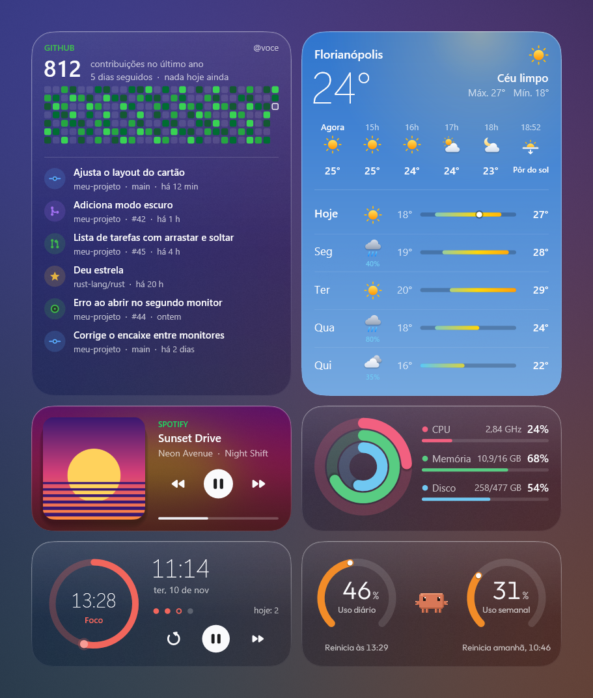
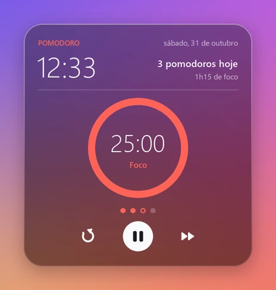
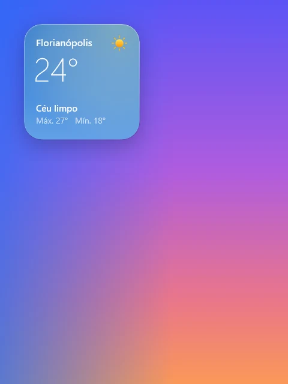
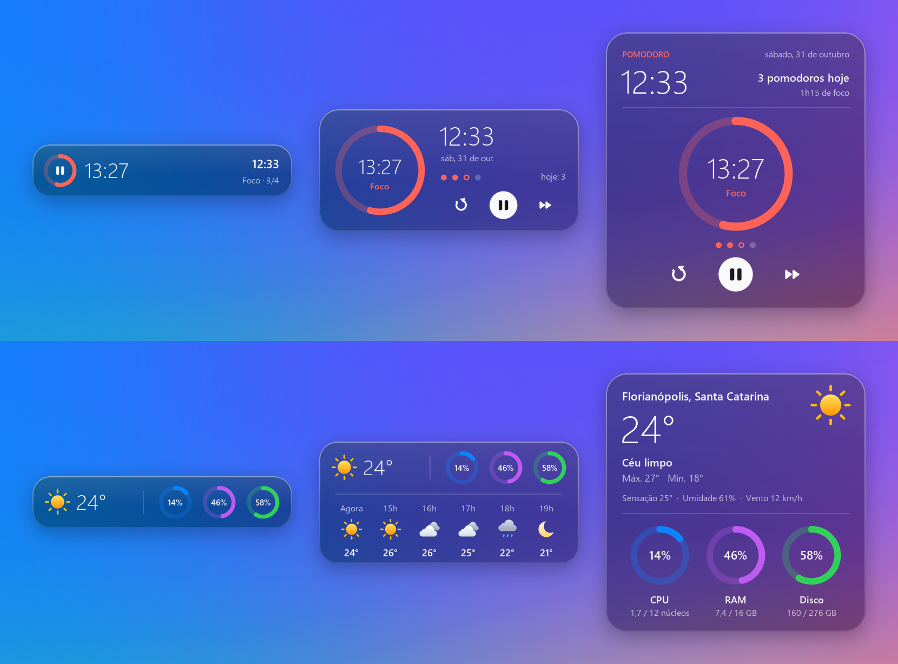
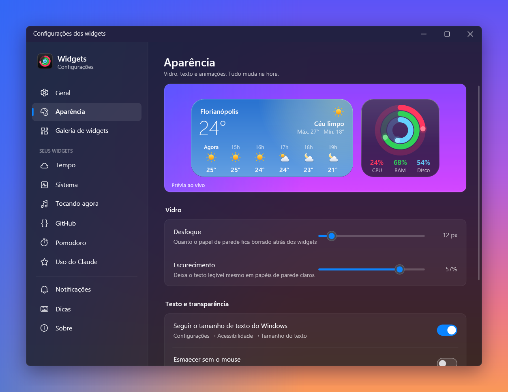
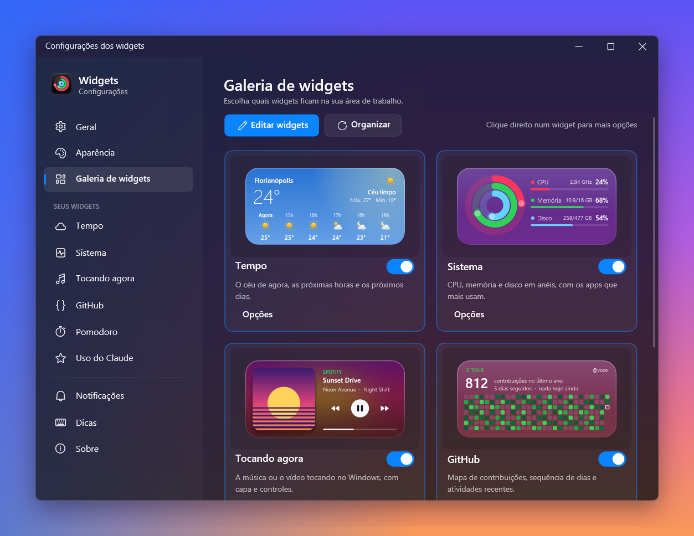
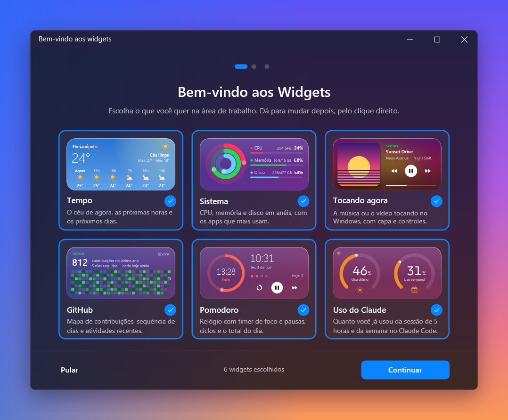

<h1 align="center">Widgets</h1>

<p align="center">
  Widgets de vidro para a área de trabalho do Windows: clima, sistema, a música que está tocando,
  seu GitHub e um relógio Pomodoro.
</p>

<p align="center">
  <a href="https://github.com/lucasschn1/Widgets/releases/latest"></a>
  
  <a href="https://github.com/lucasschn1/Widgets/releases"></a>
</p>

<p align="center">
  
</p>

Eles ficam presos ao papel de parede, atrás das janelas, e o fundo de cada um é o próprio
papel de parede desfocado, como um vidro fosco. Quando o mouse sai de cima, ficam um pouco
mais transparentes, para não roubar a atenção.

## Instalar

Abra o **PowerShell** e cole:

```powershell
irm https://raw.githubusercontent.com/lucasschn1/Widgets/main/install.ps1 | iex
```

Pronto. Não precisa ser administrador, e o programa inteiro é um único `Widgets.exe` de 2,5 MB
que abre na hora. Se preferir o jeito tradicional, baixe o
**[Widgets-Setup.exe](https://github.com/lucasschn1/Widgets/releases/latest)** e siga o
instalador.

> Na primeira vez, o Windows pode avisar que "protegeu o computador". É porque o app não tem
> uma assinatura digital paga. Clique em **Mais informações** e depois em **Executar assim mesmo**.

Quando sair uma versão nova, o próprio app avisa e atualiza com um clique. Para desinstalar,
é pelo caminho de sempre: Configurações → Aplicativos → Widgets.

## O que vem junto

**Tempo** tem o céu de agora como fundo: azul de dia, escuro de noite, cinza quando fecha, com
a chuva (ou a neve) caindo de verdade. Mostra as próximas horas e, no tamanho grande, os
próximos dias com a faixa de mínima e máxima. Avisa quando vai começar a chover.

**Sistema** mostra CPU, memória e disco em três anéis, com a porcentagem e quanto está em uso
agora (a velocidade da CPU em GHz, a memória e o disco em GB). Clique num anel e o widget vira
para mostrar os 3 apps que mais usam aquele recurso (no disco, as unidades). No tamanho
grande, aparecem os 5 primeiros, cada um com o seu ícone, junto com a rede e há quanto tempo o
PC está ligado.

**Tocando agora** acompanha o que estiver tocando no Windows (Spotify, YouTube no navegador e
outros). O fundo ganha as cores da capa. No tamanho grande, há também o volume do app,
aleatório e repetir; clique na barra de progresso para pular. A roda do mouse em cima dele muda
o volume do app que está tocando.

**GitHub** traz o mapa de contribuições, a sequência de dias e as últimas atividades. Se você
usa o [GitHub CLI](https://cli.github.com/), entram também os repositórios privados e um aviso
quando alguém pede sua revisão.

**Pomodoro** é um relógio com timer de foco e pausas. Ele conta os ciclos até a pausa longa,
soma quanto você focou no dia, e começa ou pausa com um clique (ou pelo clique direito).

<p align="center">
  
</p>

## Do tamanho que você quiser

Cada widget tem três tamanhos. Clique no botão que aparece no canto, ou dê dois cliques no
widget. Os vizinhos se ajeitam sozinhos. O pequeno é um quadrado: dois lado a lado ocupam a
largura de um médio.

<p align="center">
  
</p>

<p align="center">
  
</p>

Para mover, é só arrastar: eles se encaixam uns nos outros e nas bordas da tela (segure `Alt`
para soltar livre).

## Configurações

Tudo muda na hora, sem botão de salvar. Dá para ajustar o quanto o vidro desfoca e escurece
(com uma prévia ao vivo), escolher quais widgets aparecem e decidir quais avisos você quer
receber.

<table>
  <tr>
    <td></td>
    <td></td>
  </tr>
</table>

Na primeira vez que você abre, umas boas-vindas rápidas ajudam a escolher os widgets e
configurar a cidade do clima.

<p align="center">
  
</p>

## Com mais de um monitor

Os widgets lembram onde ficam em cada combinação de telas. Se você tira o notebook do monitor
externo, eles vão para a tela do notebook sem ficar um em cima do outro; quando você conecta de
novo, cada um volta para onde estava. Numa combinação nova (o notebook virou a segunda tela, ou
mudou de lado), eles ficam no mesmo canto do mesmo monitor, no tamanho certo para a escala dele.

Avisos e janelas abrem no monitor onde está o mouse. Um jogo ou vídeo em tela cheia pausa só os
widgets daquele monitor, e cada tela usa o próprio papel de parede no vidro.

## Tudo no clique direito

O app não usa atalhos de teclado globais, para não roubar combinações de outros programas (nem o
AltGr do teclado ABNT2). Tudo fica no menu do clique direito, num widget ou no ícone da bandeja:

| | |
|---|---|
| Mostrar na frente | Traz os widgets para a frente das janelas |
| Modo edição | Fecha, redimensiona e move tudo de uma vez (e tem "Desfazer") |
| Modo foco | Esconde os widgets por 30 min, 1 h, 2 h ou até você desligar |
| Layouts | Guarda e troca arrumações dos widgets |
| No Pomodoro | Começar, pausar, pular de fase e mudar as durações |

---

## Para quem quer mexer no código

O app é escrito em [Rust](https://www.rust-lang.org/) e conversa direto com o Windows: Direct2D
e DirectWrite para desenhar, WinRT para saber o que está tocando. Para compilar, instale o Rust
pelo [rustup](https://rustup.rs) (ele oferece as ferramentas de compilação do Visual Studio, se
faltarem) e rode:

```powershell
cargo run            # versão de teste, com opções separadas em %APPDATA%\Widgets-dev
cargo build --release
```

A versão de teste pode ficar aberta junto com a instalada: ela usa outra pasta de opções, outro
ícone na bandeja e outra entrada em "iniciar com o Windows". A versão final guarda tudo em
`%APPDATA%\Widgets`, no mesmo formato da versão 2 (em Python), então quem atualiza não perde
nada.

<details>
<summary><b>Como o código está organizado</b></summary>

```
install.ps1           instalador de uma linha (baixa o último Release)
packaging/            build.ps1 (Widgets.exe e .zip) e o instalador do Inno Setup
res/                  ícone e manifesto embutidos no Widgets.exe (pelo build.rs)
src/
  main.rs             inicia o app e roda o laço de mensagens
  app.rs              cria os widgets e coordena arraste, encaixe, menus, avisos e modos
  app_panels.rs       a parte do app que cuida das configurações, perguntas e boas-vindas
  config.rs           lê e grava as opções (config.json e cache.json), com os valores padrão
  shared.rs           o estado que todos os widgets consultam
  card.rs             a base de todo widget (tamanhos, botão de tamanho, modo edição)
  gfx.rs              desenho com Direct2D, DirectWrite e WIC
  backdrop.rs         o vidro: o papel de parede desfocado atrás dos cartões
  theme.rs            medidas, cores e ícones
  events.rs           janelas do Windows e a fila de eventos
  panel.rs            o motor das janelas desenhadas (controles e campos de texto)
  settings.rs         as páginas das configurações
  prompt.rs           as perguntas de vidro, as sugestões de cidade e as boas-vindas
  popup.rs            o menu de vidro e os avisos com "Desfazer"
  overlay.rs          guias de encaixe e dicas do mouse
  tray.rs             ícone na bandeja e notificações
  updates.rs          procurar e instalar versões novas
  startup.rs          iniciar com o Windows
  win.rs, util.rs, imgops.rs, drawing.rs
  widgets/
    mod.rs            a lista de widgets e o trait `Kind`, que todo widget implementa
    system.rs, media.rs, github.rs, pomodoro.rs
```

</details>

<details>
<summary><b>Criando um widget novo</b></summary>

1. Crie um arquivo em `src/widgets/` com um tipo que implemente `Kind`. O essencial é `key`,
   `title`, `layout(mode)` (o tamanho do cartão em cada modo) e `draw`, e os outros métodos
   (`hit`, `act`, `tick`, `menu`, `tooltip`...) têm um padrão que não faz nada.
2. Coloque a chave em `KEYS` e o widget em `create`, `title`, `description`, `icon_name` e
   `sample` (os dados de exemplo da miniatura da galeria), todos em `src/widgets/mod.rs`.
3. Se quiser uma página própria nas configurações, crie uma em `src/settings.rs`, seguindo as
   que já existem.

Uma opção geral nova vai em `config.rs`, com o valor padrão. As configurações não têm botão de
salvar: `set_setting` grava e aplica na hora.

</details>

<details>
<summary><b>Lançando uma versão</b></summary>

1. Mude `version` no `Cargo.toml` e faça o commit.
2. Crie e envie a tag: `git tag v3.1.0` e depois `git push origin main v3.1.0`.

O GitHub Actions compila o `Widgets.exe`, gera o `.zip` e o instalador e publica o Release.
Quem já tem o app instalado recebe o aviso de atualização. Para gerar o `.zip` na sua máquina,
rode `packaging\build.ps1`.

</details>

<details>
<summary><b>A versão 2, em Python</b></summary>

Até a versão 2.0 o app era em Python, com Pillow e Tkinter. O código dessa época continua
no histórico, na tag [`v2.0.0`](https://github.com/lucasschn1/Widgets/tree/v2.0.0). Com a reescrita em Rust, o
download caiu de 22 MB para cerca de 1 MB, e o app passou a usar mais ou menos metade da memória.

</details>
